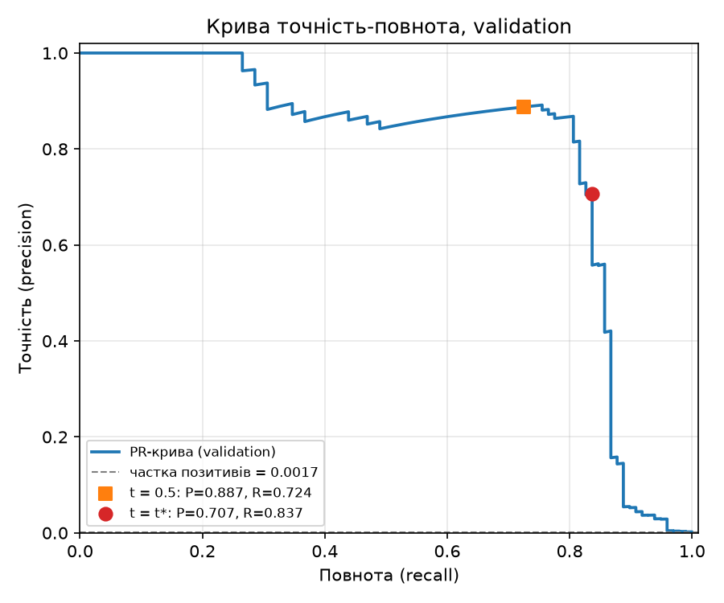
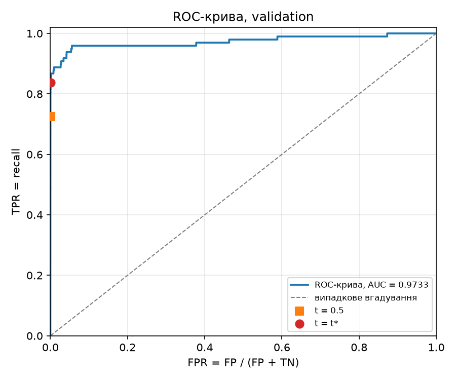
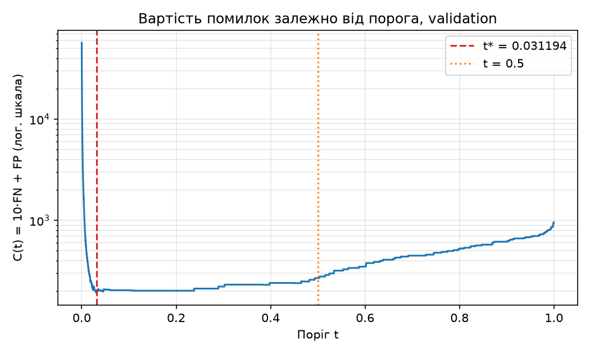

# ЛР2. Поріг рішення під асиметричну ціну помилок

Задача: виявлення шахрайських транзакцій (Credit Card Fraud Detection). Модель одна й та сама, змінюється лише **поріг** `t`, за яким оцінка `s` перетворюється на рішення «шахрайство / ні». Ціна помилок асиметрична: пропущене шахрайство коштує вдесятеро більше за хибну тривогу.

- Набір: [Credit Card Fraud Detection (Kaggle)](https://www.kaggle.com/datasets/mlg-ulb/creditcardfraud), файл `creditcard.csv`: 284 807 транзакцій, 492 шахрайські. Сам файл у репозиторій **не додано**.
- Стек: Python 3.12, NumPy, pandas, scikit-learn, PyTorch (CPU, float32), Matplotlib. Версії зафіксовано в `uv.lock` та `requirements.txt` (numpy 2.5.4, pandas 3.0.6, scikit-learn 1.9.1, torch 2.14.1, matplotlib 3.11.2).

## Запуск

```bash
cd lab2
uv sync

# 1) навчання з локального CSV (тека --out має бути порожньою або неіснуючою)
uv run python lab2_starter.py --data /шлях/до/creditcard.csv --out results

# 2) аналіз зі збережених прогнозів, без навчання і без CSV
uv run python analysis.py --saved results --out analysis
```

Перевірити, що збережені дані завантажуються: `uv run python lab2_starter.py --saved results`.

## Структура

| Шлях | Вміст |
|---|---|
| `lab2_starter.py` | підготовка даних, навчання, збереження прогнозів (код викладача, без змін) |
| `lab2_analysis.py` | пункти 2-4: метрики, пошук порога, перевірки, тест, аналіз помилок |
| `results/` | `model.pt` (ваги), `predictions.npz` (індекси поділу, мітки, Amount, оцінки без округлення), `preprocessing.npz`, `run.json`, `split_summary.csv` |
| `analysis/validation_candidates.csv` | повна таблиця кандидатів (55 980 рядків): `threshold, TP, FP, FN, TN, C` |
| `analysis/threshold.json` | зафіксований поріг `t*` |
| `analysis/pr_curve_validation.png`, `roc_curve_validation.png` | дві криві на validation |
| `analysis/cost_vs_threshold_validation.png` | допоміжний графік `C(t)` |
| `analysis/check_{A,B,C}_{fast,bruteforce}.csv` | таблиці перевірки пошуку порога |
| `analysis/test_summary.csv`, `test_error_examples.csv`, `summary.json` | результати на test |

## 1. Дані, поділ і навчання

Ознаки: `V1`-`V28` та `Amount` (29 штук); `Class` і `Time` у модель не потрапляють. Сире `Amount` зберігається окремо для аналізу помилок. Поділ 60/20/20 зі стратифікацією за `Class`, у два кроки `train_test_split` (`test_size=0.4`, потім `test_size=0.5`, `random_state=0`). `StandardScaler` навчено лише на train. Класи не балансувалися.

Модель: `Linear(29,32) → ReLU → Linear(32,1)`, `BCEWithLogitsLoss`, Adam з `lr=1e-3`, 12 епох, пакет 1024, ваги останньої епохи. Оцінка `s = sigmoid(z)`, де `z` - логіт.

| Вибірка | Об'єктів | Шахрайських | Частка |
|---|---:|---:|---:|
| train | 170 884 | 295 | 0,1726 % |
| validation | 56 961 | 98 | 0,1720 % |
| test | 56 962 | 99 | 0,1738 % |

Сума шахрайських: 295 + 98 + 99 = 492, стратифікація зберегла частку класу майже однаковою.

**Чому статистики стандартизації не можна рахувати на всьому наборі.** Тоді середнє й стандартне відхилення містили б інформацію про validation і test, тобто відбувся б витік даних: перетворення «бачило» б дані, на яких модель потім оцінюється, а оцінки якості стали б оптимістичними. На практиці нових даних у момент навчання немає, тому scaler має залежати лише від train, а до validation і test застосовуються ті самі `mean` і `scale`.

## 2. Вибір порога на validation

Правило: передбачаємо шахрайство, якщо `s_i ≥ t`. Підрахунок:

- `TP` - шахрайство, передбачене як шахрайство; `FP` - легітимна, передбачена як шахрайство (хибна тривога);
- `FN` - шахрайство, яке пропущено; `TN` - легітимна, передбачена як легітимна;
- вартість `C(t) = 10·FN(t) + FP(t)`; `Amount` у вартість не входить.

### Пошук порога за O(n log n)

1. Сортуємо оцінки за спаданням (`argsort`), порядок міток відповідно переставляємо.
2. `cum_tp = cumsum(y)`, `cum_fp = cumsum(1 − y)`: для перших `k` об'єктів це кількість `TP` і `FP`, якщо поріг стоїть одразу після `k`-го.
3. **Рівні оцінки** мають однаковий прогноз, тому поріг можна ставити лише між групами. Беремо останню позицію кожної групи рівних оцінок: там `s_sorted[k] ≠ s_sorted[k+1]`. Так усі об'єкти з `s ≥ t` потрапляють у позитивний прогноз одночасно.
4. `FN = P − TP`, `TN = N − FP`, `C = 10·FN + FP`.
5. Додаємо кандидата `+∞` (`TP = FP = 0`, «усі негативні»). Найменша оцінка дає «усі позитивні».
6. Мінімум `C`; **якщо мінімум досягається на кількох порогах, береться найбільший**. Таблиця будується векторно, без проходу по вибірці для кожного порога; сортування дає `O(n log n)`, решта - `O(n)`.

Кандидатів: 55 980 (унікальні оцінки validation + `+∞`). Мінімум вартості досягається єдиний раз, тому правило нічиєї тут не спрацьовує (воно перевірено на наборі C).

### Підсумок на validation

| Правило на validation | Поріг | TP | FP | FN | TN | C |
|---|---:|---:|---:|---:|---:|---:|
| Стандартний поріг | 0,5 | 71 | 9 | 27 | 56 854 | 279 |
| Мінімум вартості | **t\* = 0,031194** (0,031193889677524567) | 82 | 34 | 16 | 56 829 | **194** |
| Усі негативні | +∞ | 0 | 0 | 98 | 56 863 | 980 |

Точність/повнота на validation: при 0,5 - 0,887 / 0,724; при `t*` - 0,707 / 0,837. Поріг `t*` зафіксовано в `analysis/threshold.json` і далі не змінюється.

### Криві та ROC-AUC




**ROC-AUC (validation) = 0,9733**; середня точність (площа під PR-кривою) = 0,785. Позначки на кривих - пороги 0,5 і `t*`.

**Чому висока ROC-AUC не гарантує малої вартості чи високої точності.**

- AUC - це ймовірність того, що випадкова шахрайська транзакція отримає більшу оцінку, ніж випадкова легітимна. Вона оцінює лише *впорядкування* і не залежить від конкретного порога та від цін помилок.
- Негативних майже у 580 разів більше, ніж позитивних (56 863 проти 98). FPR 1 % - це вже ≈570 хибних тривог проти 98 справжніх шахраїв. У ROC така помилка майже непомітна (крива біля лівого краю), а на точності та вартості вона катастрофічна.
- Точність залежить від частки позитивів (`precision = TP / (TP + FP)`), а AUC - ні. Тому за AUC ≈ 0,97 точність при `t*` усе одно лише ≈ 0,71, а середня точність - 0,785.
- Вартість `10·FN + FP` залежить від обраної точки на кривій і від співвідношення цін; AUC усереднює по всіх порогах, зокрема й по тих, які нікому не потрібні. Плюс AUC не відображає калібрування оцінок.



## 3. Перевірка реалізації пошуку порога

Для кожного набору таблицю кандидатів побудовано швидким алгоритмом (кумулятивні суми) і незалежним прямим перебором (для кожного кандидата правило `s_i ≥ t` застосовується до всіх елементів списком). Побудований перебір не використовує швидкий алгоритм. Усі лічильники та вартості збіглися точно (CSV-файли `fast` і `bruteforce` побайтово однакові), вибрані пороги збіглися і з ручним розрахунком. Тест оцінювався лише після цього, і в коді цей порядок захищений `assert`.

**Набір A**: `s = [0,9; 0,7; 0,7; 0,4; 0,2; 0,1]`, `y = [0; 1; 0; 1; 0; 0]`

| Поріг | TP | FP | FN | TN | C |
|---:|---:|---:|---:|---:|---:|
| +∞ | 0 | 0 | 2 | 4 | 20 |
| 0,9 | 0 | 1 | 2 | 3 | 21 |
| 0,7 | 1 | 2 | 1 | 2 | 12 |
| **0,4** | 2 | 2 | 0 | 2 | **2** |
| 0,2 | 2 | 3 | 0 | 1 | 3 |
| 0,1 | 2 | 4 | 0 | 0 | 4 |

`t* = 0,4`, `C = 2`.

**Набір B**: `s = [0,9; 0,6; 0,3]`, `y = [0; 0; 0]`

| Поріг | TP | FP | FN | TN | C |
|---:|---:|---:|---:|---:|---:|
| **+∞** | 0 | 0 | 0 | 3 | **0** |
| 0,9 | 0 | 1 | 0 | 2 | 1 |
| 0,6 | 0 | 2 | 0 | 1 | 2 |
| 0,3 | 0 | 3 | 0 | 0 | 3 |

`t* = +∞`, `C = 0`.

**Набір C**: `s = [0,8; 0,5 ×11; 0,2]`, `y = [1; 1; 0 ×10; 0]`

| Поріг | TP | FP | FN | TN | C |
|---:|---:|---:|---:|---:|---:|
| +∞ | 0 | 0 | 2 | 11 | 20 |
| **0,8** | 1 | 0 | 1 | 11 | **10** |
| 0,5 | 2 | 10 | 0 | 1 | **10** |
| 0,2 | 2 | 11 | 0 | 0 | 11 |

`t* = 0,8` (серед двох порогів з `C = 10` вибрано більший).

**Що перевіряє кожен набір.**

- **A (рівні оцінки 0,7 і 0,7).** Два об'єкти з однаковою оцінкою не можна розділити порогом: у таблиці є лише поріг 0,7, що дає `TP = 1, FP = 2` одразу для обох; проміжного стану «`FP = 1`» не існує. Якби алгоритм ставив поріг після кожного елемента, а не після кожної групи, з'явилися б неможливі рядки.
- **B (немає позитивних міток).** `P = 0`, тому `FN = 0` завжди і мінімум `C = 0` досягається лише при `+∞` (всі інші пороги дають `FP > 0`). Перевіряється кандидат `+∞` та граничний випадок `P = 0`. Тут же `recall` не визначений (`TP + FN = 0`), а `precision` при `+∞` теж (`TP + FP = 0`).
- **C (дві різні точки з однаковою вартістю).** `C(0,8) = 10·1 + 0 = 10` і `C(0,5) = 10·0 + 10 = 10`. Перевіряється правило нічиєї: обирається більший поріг 0,8 (менше позитивних прогнозів за рівної вартості). Також 11 рівних оцінок 0,5 - ще один тест групування.

## 4. Оцінка на test

Поріг `t* = 0,031194` застосовано до test один раз; модель, поріг і налаштування навчання за test не змінювалися. Рядки «0,5» та «+∞» подано лише для порівняння.

| Правило | Поріг | TP | FP | FN | TN | C | Precision | Recall |
|---|---:|---:|---:|---:|---:|---:|---:|---:|
| Стандартний поріг | 0,5 | 71 | 8 | 28 | 56 855 | 288 | 0,8987 | 0,7172 |
| **Мінімум вартості (t\*)** | 0,031194 | **80** | **43** | **19** | 56 820 | **233** | **0,6504** | **0,8081** |
| Усі негативні | +∞ | 0 | 0 | 99 | 56 863 | 990 | не визначена | 0,0000 |

Формули: `precision = TP/(TP+FP)`, `recall = TP/(TP+FN)`. Для «усіх негативних» `TP + FP = 0`: модель нічого не позначила шахрайством, тому частка правильних серед позначених не існує (ділення 0/0), і метрика не визначена. Вона не дорівнює 0 чи 1 за домовленістю.

### Розібрані помилки (t\* = 0,031194)

Перші п'ять за номером рядка CSV (нумерація з 0, без заголовка):

| Рядок CSV | Тип | Мітка | Оцінка s | Amount | s − t\* |
|---:|:---:|:---:|---:|---:|---:|
| 460 | FP | 0 | 0,1962 | 2,00 | +0,1650 |
| 2961 | FP | 0 | 0,0810 | 2,49 | +0,0498 |
| 10783 | FP | 0 | 0,9663 | 89,99 | +0,9351 |
| 13405 | FP | 0 | 0,9320 | 89,99 | +0,9008 |
| 13617 | FP | 0 | 0,9228 | 89,99 | +0,8916 |
| 10497 | FN | 1 | 0,0115 | 3,79 | −0,0197 |
| 52521 | FN | 1 | 0,0064 | 105,99 | −0,0248 |
| 55401 | FN | 1 | 0,0056 | 1,00 | −0,0256 |
| 91671 | FN | 1 | 0,0005 | 290,18 | −0,0307 |
| 93486 | FN | 1 | 0,0184 | 0,00 | −0,0128 |

**Amount.** У цих прикладах FP мають переважно малі суми (2,00 і 2,49), але три однакові 89,99, FN - від 0 до 290. Медіана Amount усіх test - 22,0; за всіма 43 FP медіана 2,49 (максимум 1000), за всіма 19 FN - 33,76 (максимум 829,41). Чіткого зв'язку з сумою немає.

**Відстань від порога.** FP розташовані над порогом: три з п'яти - далеко (оцінка > 0,89, модель «впевнена»), два - близько до `t*`; за всіма 43 FP медіана `s − t*` дорівнює лише +0,025, тобто більшість хибних тривог - це «погранична» зона, яку відкрив зниженням порога. FN усі лежать трохи нижче порога: за всіма 19 медіана −0,029, а мінімум −0,031. Це не випадковість: оцінка не може бути меншою за 0, тому відстань під порогом обмежена `t* ≈ 0,031`. Тож за самою відстанню «FN близько до порога» не можна стверджувати, що модель майже вгадала: приклад 91671 має `s = 0,0005`, тобто модель була практично впевнена, що це легітимна транзакція.

**Чи можна за десятьма прикладами судити про причину помилок?** Ні. Десять рядків - це вибірка з 62 помилок, до того ж «перші за номером рядка», а не випадкові (рядки CSV упорядковані за часом, тож вони з одного періоду). Три FP з однаковою сумою 89,99 натякають на повторюваний шаблон (можливо, однотипні покупки), але це гіпотеза: щоб її перевірити, потрібні всі помилки, порівняння з тими правильними прикладами, що мають подібні ознаки, і не test, якщо результат використовується для зміни моделі. Причину помилок за десятьма прикладами встановити не можна.

## Висновки

**Що змінив вибір порога.** Модель не змінювалась: ті самі ваги та ті самі оцінки. Змінилось лише рішення. Із `t = 0,5` на `t* ≈ 0,031` модель стала позначати шахрайством значно більше транзакцій: оскільки пропуск шахрайства вдесятеро дорожчий за хибну тривогу, оптимальна точка зсувається в бік високої повноти.

**Ціна рішення в термінах FP і FN (test).** `FN` знизилося з 28 до 19 (−9 пропущених шахрайств, економія 90 одиниць вартості), але `FP` зросло з 8 до 43 (+35 хибних тривог, +35 одиниць). Чиста вигода: `C` зменшилась з 288 до 233 (−55, тобто −19 %), recall зріс з 0,717 до 0,808, а precision впав з 0,899 до 0,650: тепер приблизно кожна третя тривога хибна. Для порівняння, «усі негативні» дають 990, тобто модель із `t*` коштує приблизно у 4,2 раза менше.

**Чому результат на validation не гарантує такого самого виграшу на test.** На validation виграш був більшим: 279 → 194 (−30,5 %), на test - 288 → 233 (−19 %). Причини:

1. `t*` вибрано мінімізацією `C` на одній скінченній вибірці з лише 98 позитивами: це оцінка з шумом, а мінімум за 55 980 кандидатами схильний підлаштовуватися під випадкові особливості саме цієї вибірки («прокляття переможця»). Порог «навчений» на validation і тому на ній оптимістичний.
2. Позитивів мало: один `FN` змінює `C` на 10, і кілька випадкових транзакцій зсувають і оптимум, і значення вартості. На test 99 позитивів, і їхній розподіл оцінок не такий самий.
3. Оцінка вартості на test теж має розкид; щоб судити про істинний виграш, потрібні довірчі інтервали (наприклад, бутстреп) або кілька незалежних поділів, чого завдання не вимагає й не робить цього.
4. Поріг - дуже низьке значення в області, де оцінки густо скупчені: невеликий зсув розподілу оцінок між вибірками змінює `FP` на десятки.

Тож вибір порога залишився корисним на test (вартість зменшилась), але виграш менший за validation-оцінку; і ця різниця - очікувана, а не помилка.

## Відтворюваність

- Поділ і статистики стандартизації відтворюються точно. Оцінки після повторного навчання можуть відрізнятися в молодших розрядах (залежність PyTorch від версії та платформи); висновки зроблено за збереженими прогнозами в `results/`, і аналіз з них дає ті самі числа, що й у цьому README.
- Числа в README отримано на Python 3.12.3 з версіями з `requirements.txt`. Файл `creditcard.csv` для цього запуску завантажено з дзеркала на GitHub (не з Kaggle); перевірено, що він має 284 807 рядків, 492 шахрайські та без пропусків.

## Джерела та використання генеративних інструментів

- Стартовий код `lab2_starter.py` та умова - від викладача.
- Код `lab2_analysis.py` і текст README підготовлено за допомогою генеративного інструмента (Claude, Anthropic); результати перевірено запуском, а розуміння формул, обробки рівних оцінок, граничних порогів і вибору серед кількох мінімумів - відповідальність автора роботи.
- Датасет: ULB Machine Learning Group, Credit Card Fraud Detection (Kaggle).
