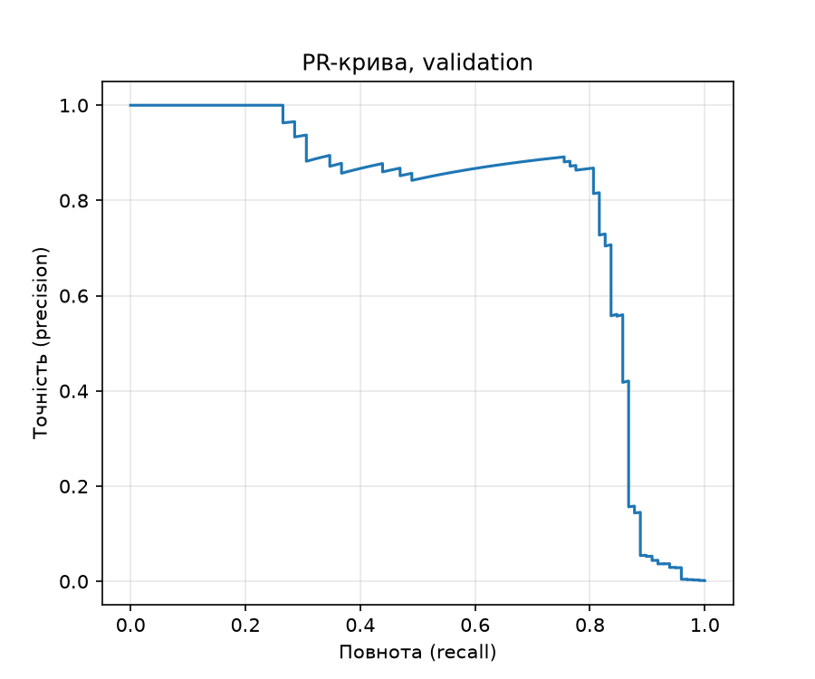
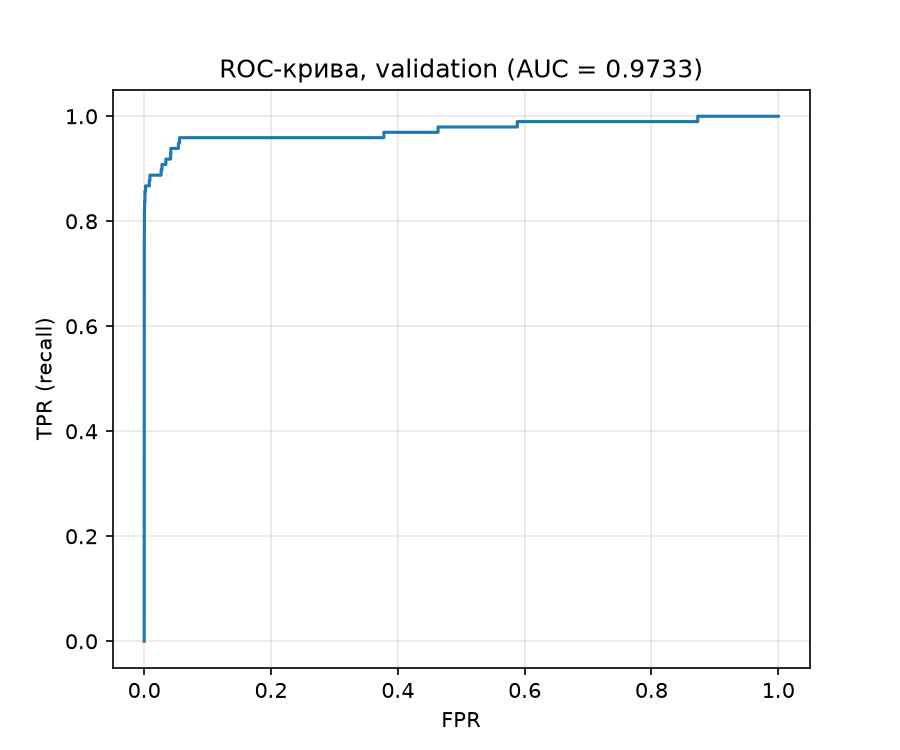

# ЛР2

Виявлення шахрайських транзакцій (Credit Card Fraud Detection). Модель **не змінюється**, змінюється лише поріг рішення `t`, який підбирається на validation під вартість помилок `C = 10·FN + FP`.

## 1. Дані, запуск, відтворюваність

**Набір:** [Credit Card Fraud Detection (Kaggle, mlg-ulb)](https://www.kaggle.com/datasets/mlg-ulb/creditcardfraud), файл `creditcard.csv` (284 807 транзакцій, 492 шахрайських). Файл у репозиторій **не додано**; для завантаження потрібен обліковий запис Kaggle. Шлях до локального CSV передається параметром `--data`.

**Ознаки:** `V1–V28` та `Amount` (29). `Class` і `Time` у модель не входять. Сире `Amount` зберігається окремо для аналізу помилок.

**Команди** (Python 3.12, залежності зафіксовано в `pyproject.toml` / `uv.lock`):

```bash
uv sync
# 1) навчання з локального CSV (один раз)
uv run python lab2_starter.py --data creditcard.csv --out results
# 2) аналіз зі збережених прогнозів
uv run python analysis.py --saved results --out analysis
```

**Версії бібліотек у моєму запуску** (`results/run.json`): Python 3.12.15, NumPy 2.5.4, pandas 3.0.6, scikit-learn 1.9.1, PyTorch 2.14.1+cpu, CPU, float32, 10 потоків.

**Структура:**

| Шлях | Вміст |
|---|---|
| `lab2_starter.py` | підготовка даних, навчання, збереження прогнозів |
| `analysis.py` | метрики, пошук порога, перевірка, тест, помилки |
| `results/model.pt` | ваги моделі після 12-ї епохи |
| `results/predictions.npz` | індекси рядків CSV (`*_row_ids`), мітки, `Amount`, оцінки `s` (без округлення) для validation і test |
| `results/preprocessing.npz` | середнє, масштаб, дисперсія `StandardScaler` (лише train) |
| `results/run.json`, `results/split_summary.csv` | налаштування запуску, розміри поділу |
| `analysis/validation_candidates.csv` | **повна** таблиця кандидатів: поріг, TP, FP, FN, TN, C |
| `analysis/pr_curve.png`, `analysis/roc_curve.png` | криві на validation |

**Відтворюваність.** Повторне навчання дає той самий поділ і ті самі статистики стандартизації. Оцінки можуть відрізнятися в молодших розрядах (залежать від версії PyTorch і платформи), тому всі числа нижче отримано зі збережених прогнозів у `results/predictions.npz`.

## 2. Поділ, підготовка даних, навчання

- Поділ 60/20/20, стратифікований, початковий порядок рядків збережено. Спершу `train_test_split(idx, test_size=0.4, stratify=Class, random_state=0)`, потім відкладені індекси діляться навпіл (`test_size=0.5`, стратифікація за відповідними мітками, `random_state=0`): перша частина це validation, друга це test.
- `StandardScaler` навчено лише на train; ті самі статистики застосовано до validation і test. Масиви переведено у float32. Класи не балансувались.
- Модель: `Linear(29,32) → ReLU → Linear(32,1)`; `BCEWithLogitsLoss` (середнє за пакетом, без вагів класів); Adam, `lr = 1e-3`; 12 епох, пакет 1024 (останній неповний пакет не відкидається); `torch.manual_seed(0)` перед створенням моделі; перемішування train через окремий `np.random.default_rng(0)` з новою перестановкою на кожній епосі.
- Використано ваги **останньої** (12-ї) епохи; епоху за validation не обирали, гіперпараметри не підбирали. BCE на train спадає монотонно: 0.3653 (епоха 1) → 0.0549 → 0.0170 → … → 0.003383 (епоха 12).
- Оцінки: `s = sigmoid(z)`, де `z` — логіт; `model.eval()` і `torch.no_grad()`.

| Вибірка | Об'єктів | Шахрайських | Частка |
|---|---:|---:|---:|
| train | 170 884 | 295 | 0.001726 |
| validation | 56 961 | 98 | 0.001720 |
| test | 56 962 | 99 | 0.001738 |

Стратифікація зберегла частку шахрайства (≈0.17 %) у всіх трьох вибірках.

**Чому статистики стандартизації не можна рахувати на всьому наборі.** Тоді середнє та стандартне відхилення містили б інформацію про validation і test (витік даних). Масштабування «підглядало б» у вибірки, які мають імітувати нові, невидимі транзакції, і оцінки якості виявились би оптимістичними. Коректно: `fit` лише на train, далі тільки `transform`.

## 3. Метрики та вартість

Правило рішення: прогноз «шахрайство», якщо `s ≥ t` (рівні оцінки отримують однаковий прогноз).

- TP: шахрайство, `s ≥ t`. FP: легітимна, `s ≥ t` (хибна тривога).
- FN: шахрайство, `s < t` (пропуск). TN: легітимна, `s < t`.
- **C(t) = 10·FN(t) + FP(t).** Пропущене шахрайство коштує 10 хибних тривог. `Amount` у вартість не входить.
- precision = TP / (TP + FP), recall = TP / (TP + FN). Якщо знаменник нульовий, метрика не визначена.

## 4. Validation: криві та ROC-AUC

 

**ROC-AUC = 0.973318.** PR-крива тримає precision ≈ 0.85–0.9 до recall ≈ 0.8, після чого різко падає (до ≈ 0.4 при recall ≈ 0.86 і майже до 0 при recall → 1).

**Чому висока ROC-AUC не гарантує малої вартості чи високої precision:**

1. ROC-AUC вимірює якість *ранжування* (імовірність, що випадкове шахрайство отримає вищу оцінку, ніж випадкова легітимна) і усереднює по всіх порогах. Вона нічого не каже про конкретний поріг.
2. Класи дуже незбалансовані (0.17 %). FPR нормується на 56 863 легітимних, тому навіть мізерний FPR дає багато хибних тривог. На `t*`: FPR = 34/56 863 ≈ 0.06 %, TPR ≈ 0.84, на ROC це майже ідеальна точка, але precision лише 82/116 ≈ 0.71.
3. Вартість асиметрична (FN ×10), і оптимальний поріг залежить від цієї ціни, а не від AUC. Модель із тим самим ранжуванням має різну `C` при різних порогах (наприклад, 279 при 0.5 і 194 при `t*`). PR-крива чутливіша до цього, бо враховує FP відносно TP.

## 5. Пошук порога

**Кандидати:** усі унікальні оцінки validation та `+∞` («усі негативні»); найменша оцінка відповідає «усі позитивні». Рівні оцінки потрапляють у прогноз разом.

**Алгоритм, `O(n log n)`:**

1. Відсортувати оцінки за спаданням (`argsort(-s, kind="stable")`), впорядкувати мітки.
2. Кумулятивні суми міток: `TP_k = cumsum(y)`, `FP_k = cumsum(1−y)`.
3. Залишити лише **останню позицію кожної групи рівних оцінок** (`s[i] != s[i+1]`), бо поріг `t = s[i]` включає всю групу. Додати кандидат `t = +∞` із `TP = FP = 0`.
4. `FN = P − TP`, `TN = N − FP`, `C = 10·FN + FP`, де `P`, `N` — кількості шахрайських і легітимних у вибірці. Жодного повторного проходу по вибірці для кожного порога.
5. Серед порогів із мінімальною `C` обирається **найбільший**.

Повна таблиця: `analysis/validation_candidates.csv`.

**Підсумок на validation:**

| Правило на validation | Поріг | TP | FP | FN | TN | C |
|---|---:|---:|---:|---:|---:|---:|
| Стандартний поріг | 0.5 | 71 | 9 | 27 | 56 854 | 279 |
| Мінімум вартості (`t*`) | **0.031194** | 82 | 34 | 16 | 56 829 | **194** |
| Усі негативні | +∞ | 0 | 0 | 98 | 56 863 | 980 |

`t* = 0.031193897128105164`; мінімум `C` досягається на одному порозі, тож нічиєї немає. Поріг зафіксовано, далі не змінюється.

## 6. Перевірка пошуку на трьох малих наборах

Для кожного набору таблиця побудована **прямим перебором** (для кожного кандидата правило `s ≥ t` застосовується до кожного елемента окремо; код `brute()`, незалежний від швидкого алгоритму) і порівняна зі швидкою реалізацією. Усі лічильники та `C` збіглися точно; тести `assert` пройдено до переходу до test.

**Набір A:** `s = [0.9, 0.7, 0.7, 0.4, 0.2, 0.1]`, `y = [0, 1, 0, 1, 0, 0]`

| Поріг | TP | FP | FN | TN | C |
|---:|---:|---:|---:|---:|---:|
| +∞ | 0 | 0 | 2 | 4 | 20 |
| 0.9 | 0 | 1 | 2 | 3 | 21 |
| 0.7 | 1 | 2 | 1 | 2 | 12 |
| 0.4 | 2 | 2 | 0 | 2 | **2** |
| 0.2 | 2 | 3 | 0 | 1 | 3 |
| 0.1 | 2 | 4 | 0 | 0 | 4 |

Обраний поріг: **0.4**. *Що перевіряє:* дві рівні оцінки 0.7 з різними мітками (одна шахрайська, одна легітимна). Поріг 0.7 мусить забирати їх **обидві** одночасно (TP = 1, FP = 2 разом із 0.9), а проміжного стану «одна з двох» не існує. Це перевіряє правильну обробку груп рівних оцінок (беремо останню позицію групи).

**Набір B:** `s = [0.9, 0.6, 0.3]`, `y = [0, 0, 0]`

| Поріг | TP | FP | FN | TN | C |
|---:|---:|---:|---:|---:|---:|
| +∞ | 0 | 0 | 0 | 3 | **0** |
| 0.9 | 0 | 1 | 0 | 2 | 1 |
| 0.6 | 0 | 2 | 0 | 1 | 2 |
| 0.3 | 0 | 3 | 0 | 0 | 3 |

Обраний поріг: **+∞**. *Що перевіряє:* відсутність позитивних міток. Кожен скінченний поріг лише додає FP, тому оптимум це граничний кандидат «усі негативні». Код не повинен падати на нульовій кількості позитивів і має включати `+∞` у кандидати.

**Набір C:** `s = [0.8, 0.5 ×11, 0.2]` (13 оцінок), `y = [1, 1, 0 ×10, 0]`: оцінка 0.8 має мітку 1; з одинадцяти оцінок 0.5 перша має мітку 1, решта десять мітку 0; оцінка 0.2 має мітку 0.

| Поріг | TP | FP | FN | TN | C |
|---:|---:|---:|---:|---:|---:|
| +∞ | 0 | 0 | 2 | 11 | 20 |
| 0.8 | 1 | 0 | 1 | 11 | **10** |
| 0.5 | 2 | 10 | 0 | 1 | **10** |
| 0.2 | 2 | 11 | 0 | 0 | 11 |

Обраний поріг: **0.8**. *Що перевіряє:* два кандидати з однаковою мінімальною вартістю (`C = 10` при 0.8 і 0.5). За умовою обирається **більший** поріг, тобто 0.8. Заодно перевіряється, що одинадцять рівних оцінок 0.5 обробляються як одна група (10 FP додаються разом).

## 7. Test (`t* = 0.031194` зафіксовано, test для підбору не використовувався)

| Правило | Поріг | TP | FP | FN | TN | C | Precision | Recall |
|---|---:|---:|---:|---:|---:|---:|---:|---:|
| Стандартний поріг | 0.5 | 71 | 8 | 28 | 56 855 | 288 | 0.8987 | 0.7172 |
| Мінімум вартості | 0.031194 | 80 | 43 | 19 | 56 820 | **233** | 0.6504 | 0.8081 |

Знаменники ненульові (TP + FP > 0 і TP + FN = 99 > 0), тому precision і recall визначені в обох рядках. Для правила «усі негативні» (TP = FP = 0) precision була б **не визначеною** (0/0), бо модель нічого не позначає як шахрайство; recall = 0.

### Перші помилки за номером рядка CSV (нумерація з 0, без заголовка)

| Рядок CSV | Тип | Мітка | Оцінка | Amount | Відстань до `t*` |
|---:|:---:|:---:|---:|---:|---:|
| 460 | FP | 0 | 0.196159 | 2.00 | +0.165 |
| 2961 | FP | 0 | 0.080961 | 2.49 | +0.050 |
| 10783 | FP | 0 | 0.966327 | 89.99 | +0.935 |
| 13405 | FP | 0 | 0.932032 | 89.99 | +0.901 |
| 13617 | FP | 0 | 0.922762 | 89.99 | +0.892 |
| 10497 | FN | 1 | 0.011464 | 3.79 | −0.020 |
| 52521 | FN | 1 | 0.006373 | 105.99 | −0.025 |
| 55401 | FN | 1 | 0.005642 | 1.00 | −0.026 |
| 91671 | FN | 1 | 0.000500 | 290.18 | −0.031 |
| 93486 | FN | 1 | 0.018352 | 0.00 | −0.013 |

(Відстань = `s − t*`; усього на test 43 FP і 19 FN, наведено перші п'ять кожного типу за номером рядка.)

**Порівняння Amount і відстані до порога.**

- *FP:* три з п'яти мають оцінку > 0.9 (далеко над порогом) і **однаковий** Amount 89.99; це не «гранична» помилка. Два інші (Amount 2.00 і 2.49) лежать ближче до порога, і за стандартним порогом 0.5 вони б не були хибними тривогами.
- *FN:* усі п'ять нижче порога, але більшість поруч із ним (відстань 0.013–0.026), крім рядка 91671 (s = 0.0005, відстань 0.031 за порогом, а в абсолютних оцінках модель майже впевнена, що це легітимна транзакція). Amount розкиданий від 0.00 до 290.18: пропуски трапляються і на дрібних, і на великих сумах.

**Чи можна за десятьма прикладами судити про причину помилок?** Ні. Це перші за номером рядка, а не випадкова чи репрезентативна вибірка з 43 FP і 19 FN; вони можуть бути зміщені (наприклад, кластер однакових сум 89.99 може бути однією серією схожих транзакцій). Малої вибірки замало для висновків про систематичні причини (діапазон сум, тип шахрайства, шум міток). Можна лише сформулювати гіпотези, які треба перевіряти на всіх помилках (розподіл Amount, оцінки FP/FN за групами, ознаки `V*`).

## 8. Висновки

**Що змінив вибір порога в роботі незмінної моделі.** Ваги моделі й оцінки `s` ті самі, змінилось лише правило рішення. Перехід від 0.5 до `t* ≈ 0.031` робить модель «чутливішою»: на test recall зріс з 0.717 до 0.808 (FN 28 → 19), а загальна вартість зменшилась з 288 до 233 (−55, ≈ −19 %). Для порівняння, тривіальне правило «усі негативні» коштувало б 990 (99 FN) на test.

**Ціна цього рішення у термінах FP і FN.** Виграш: −9 FN, що дає −90 до вартості. Плата: +35 FP (8 → 43), що дає +35. Чисто −55. Також precision впала з 0.899 до 0.650, тобто майже кожна третя тривога хибна. Це виправдано лише за умови, що пропущене шахрайство справді коштує у ≈ 10 разів більше за хибну тривогу.

**Чому результат на validation не гарантує такого самого виграшу на test.**

1. `t*` підібрано під конкретну validation-вибірку (98 шахрайських), тому він частково підлаштований під її випадковості; на нових даних це оптимістична оцінка. Для порівняння: на validation вартість впала з 279 до 194 (−85, ≈ −30 %), а на test лише −55 (≈ −19 %).
2. Позитивних дуже мало: зсув на кілька FN змінює `C` на десятки одиниць, оцінка порога має велику дисперсію. Крива `C(t)` біля мінімуму може бути пласкою, а оптимум нестійким (на validation єдиний мінімум, на test він міг би бути іншим).
3. Валідаційна й тестова вибірки — різні випадкові підвибірки, розподіл оцінок може злегка відрізнятися. Тому вибір порога на validation і оцінка на test коректні, але виграш на test слід розглядати як **окрему, чесну оцінку**, а не підтвердження числа з validation.

## 9. Джерела

При написані коду аналізу (`analysis.py`) та при оформленні README використано генеративний помічник (Claude, Anthropic)