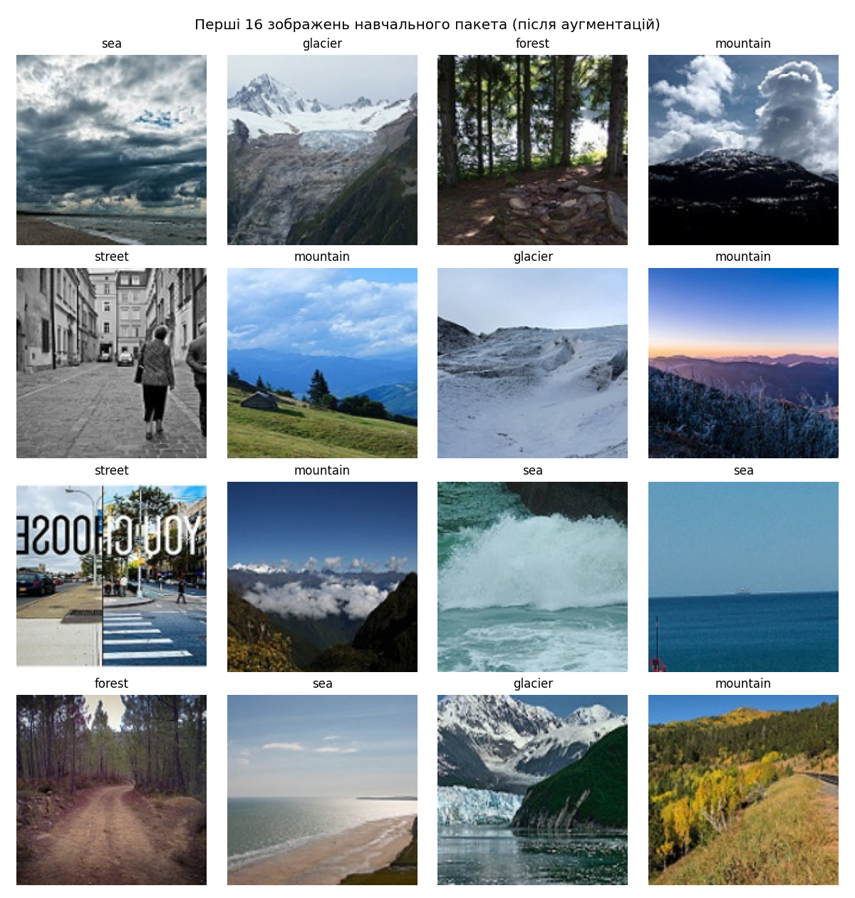
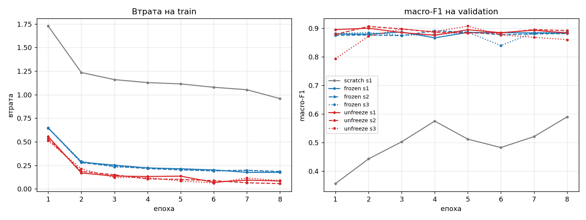
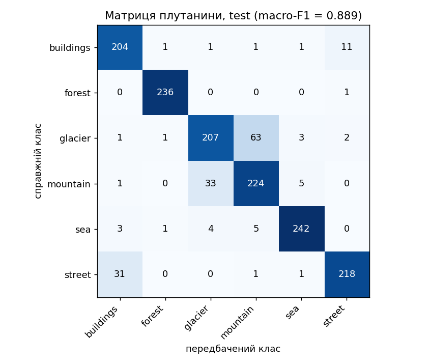
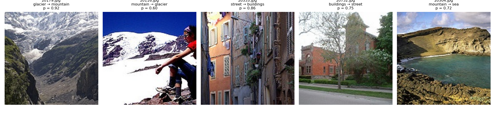

# ЛР3. Обчислювальний експеримент і трансферне навчання (ResNet-18, Intel Image Classification)

Порівняння трьох режимів навчання ResNet-18 на малій вибірці (1200 train-зображень, 6 класів) за однакового бюджету 8 епох × 38 кроків = 304 кроки оптимізатора: **scratch** (випадкові ваги, навчається все), **frozen** (ваги ImageNet, навчається лише `fc`), **unfreeze** (ваги ImageNet, навчаються `layer4` і `fc`).

## Запуск

```bash
uv lock
uv run python train.py   --data-root dataset   # поділ, перевірки п.1-2, 7 запусків, вибір, lab3_model.pt (test не використовується)
uv run python analyze.py --data-root dataset   # перевірка хешу, таблиця, криві, ефекти, test (CPU), матриця, п'ять помилок
```

`--data-root` - тека з `seg_train/seg_train/...` і `seg_test/seg_test/...`. Набір до репозиторію не додано.
Перевірки п.1-2 пише `train.py` у `results/checks.md`, усі числа п.3-5 (включно з test) - `analyze.py` у `results/analysis.md`; нижче вони перенесені звідти без змін.

## Структура

| Файл | Призначення |
|---|---|
| `common.py` | поділ, дані, перетворення, модель, режими, `set_train_mode`, оцінка, правило вибору |
| `train.py` | команда навчання |
| `analyze.py` | команда аналізу й одноразової тестової оцінки |
| `pyproject.toml` | залежності з фіксованими версіями |
| `split.csv` | поділ (`file,label,part`), SHA-256 `d3a611aec41f6e335ab58287f10a443f3e0e35aa9adfefae662d48b15af567f9` |
| `runs/<режим>_seed<зерно>/` | `run.json` (журнал) і `val_logits.npy` для кожного з 7 запусків |
| `lab3_model.pt` | ваги вибраного запуску (frozen, зерно 3) |
| `results/` | `checks.md`, `analysis.md`, `batch_after_transforms.png`, `curves.png`, `confusion_matrix.png`, `five_errors.png`, `test_logits.npy` |

## Умови виконання та відхилення

- Пристрій: **CPU** (усі сім запусків і тестова оцінка), float32. Версії Python, PyTorch, torchvision записані в кожному `run.json`.
- Відхилень від фіксованих налаштувань немає.
- Усі сім запусків зроблено на одному коміті `920b1948` (різних комітів між запусками немає). У журналах стоїть `uncommitted_changes = true`: функція `git_info` вважає змінами також неслідковані файли (`split.csv`, `runs/`, `results/`), які створює сам `train.py`. Код між комітом і запусками не змінювався.
- Зовнішній код і генеративні інструменти: код і чернетку README підготовлено за допомогою Claude (Anthropic); запуски, перевірки, числа й висновки отримано та перевірено під час виконання роботи. Ваги ImageNet - `torchvision` (`IMAGENET1K_V1`).

---

## 1. Перевірки до навчання

### 1.1 Поділ

Кількість / сума числових імен файлів. Усі 18 клітинок збігаються з контрольною таблицею: **так**. Жоден файл не входить у дві частини: **так** (перевірено перетином множин імен).

| Клас | train | validation | test |
|---|---|---|---|
| buildings | 200 / 1 996 761 ✓ | 218 / 4 837 323 ✓ | 219 / 4 837 559 ✓ |
| forest | 200 / 2 032 625 ✓ | 237 / 5 276 962 ✓ | 237 / 5 291 326 ✓ |
| glacier | 200 / 2 183 923 ✓ | 276 / 6 135 652 ✓ | 277 / 6 157 250 ✓ |
| mountain | 200 / 1 950 345 ✓ | 262 / 5 789 535 ✓ | 263 / 5 849 765 ✓ |
| sea | 200 / 1 987 613 ✓ | 255 / 5 655 068 ✓ | 255 / 5 668 011 ✓ |
| street | 200 / 1 841 817 ✓ | 250 / 5 541 845 ✓ | 251 / 5 547 533 ✓ |
| Разом | 1200 / 11 993 084 | 1498 / 33 236 385 | 1502 / 33 351 444 |

### 1.2 Пакет після перетворень



Перші 16 зображень навчального пакета після `RandomResizedCrop` і `RandomHorizontalFlip`, з оберненим нормуванням; над кожним - мітка. Видно, що аугментації застосовано: дзеркальний напис на знімку класу street - наслідок `RandomHorizontalFlip`; мітки відповідають вмісту.

### 1.3 Початкова втрата

Зерно 1, перший навчальний пакет, після `set_train_mode`, під `torch.no_grad()`, до жодного кроку оптимізатора. Еталон - рівномірний прогноз: ln 6 = 1.7918.

| Режим | Втрата L0 | L0 − ln 6 |
|---|---|---|
| scratch | 2.1344 | +0.3427 |
| frozen | 2.2155 | +0.4238 |

**Пояснення відхилення.** Рівномірний прогноз ln 6 досягається лише за нульових логітів. У обох режимах `fc` має стандартну випадкову ініціалізацію, а на вхід йдуть ознаки avgpool, які невід'ємні й мають ненульовий масштаб, тому логіти випадкові й різні для різних класів. Випадкові логіти зі стандартним відхиленням σ піднімають очікувану крос-ентропію приблизно на (5/12)σ² над ln 6; відхилення +0.34 і +0.42 відповідають σ ≈ 0.9 і 1.0 (груба оцінка). Додає шум і те, що це лише один пакет із 32 зображень. У frozen відхилення трохи більше, ймовірно, через більший масштаб ознак ImageNet. Обидві втрати близькі до ln 6 (а не на порядок більші), що відповідає правильно ініціалізованій моделі й правильним міткам.

## 2. Перевірки режимів навчання

Кожна перевірка починається з нового екземпляра моделі (кроки 1–5, зерно 1).

### 2.1 Параметри та групи оптимізатора

| Режим | Усього | requires_grad=True | Очікувано | Групи (параметрів, lr) | requires_grad=False в оптимізаторі |
|---|---|---|---|---|---|
| scratch | 11 179 590 | 11 179 590 | 11 179 590 | all: 11 179 590, lr=0.003 | жодного ✓ |
| frozen | 11 179 590 | 3 078 | 3 078 | fc: 3 078, lr=0.003 | жодного ✓ |
| unfreeze | 11 179 590 | 8 396 806 | 8 396 806 | fc: 3 078, lr=0.003; layer4: 8 393 728, lr=0.0003 | жодного ✓ |

Усі числа збігаються з таблицею режимів; у всіх режимах `weight_decay = 1e-4`.

### 2.2 Що змінюється під час навчання

5 кроків оптимізатора на перших 5 пакетах після `set_train_mode`; порівняння точне (`torch.equal`).

**frozen**

| Модуль | Параметри змінилися | Ковзні статистики BN змінилися | Збігається з очікуваним |
|---|---|---|---|
| conv1 | ні | немає BN | так |
| bn1 | ні | ні | так |
| layer1 | ні | ні | так |
| layer2 | ні | ні | так |
| layer3 | ні | ні | так |
| layer4 | ні | ні | так |
| fc | так | немає BN | так |

**unfreeze**

| Модуль | Параметри змінилися | Ковзні статистики BN змінилися | Збігається з очікуваним |
|---|---|---|---|
| conv1 | ні | немає BN | так |
| bn1 | ні | ні | так |
| layer1 | ні | ні | так |
| layer2 | ні | ні | так |
| layer3 | ні | ні | так |
| layer4 | так | так | так |
| fc | так | немає BN | так |

### 2.3 Дослід із навмисною помилкою (frozen, `model.train()` замість `set_train_mode`)

**Прогноз (записано до запуску).** У заморожених модулях (conv1, layer1–layer4) параметри не зміняться (`requires_grad=False`, оптимізатор їх не бачить), а ковзні статистики BN (`running_mean`, `running_var`, `num_batches_tracked`) зміняться в усіх BN-шарах, бо `model.train()` вмикає їх оновлення. `fc` змінюється як завжди. З кривої втрати на train це було б непомітно: градієнти йдуть лише в `fc`, втрата однаково спадає.

**Результат.**

| Модуль | Параметри змінилися | Ковзні статистики BN змінилися | Збігається з прогнозом |
|---|---|---|---|
| conv1 | ні | немає BN | так |
| bn1 | ні | так | так |
| layer1 | ні | так | так |
| layer2 | ні | так | так |
| layer3 | ні | так | так |
| layer4 | ні | так | так |
| fc | так | немає BN | так |

Прогноз збігся з результатом. У `layer1.0.bn1` після 5 кроків: max |Δ running_mean| = **8.858e-02**, max |Δ running_var| = **1.484e-01** (із `set_train_mode` обидві зміни дорівнюють 0).

**Чому `requires_grad=False` не захищає ці значення.** `requires_grad` стосується лише параметрів: він забороняє обчислювати для них градієнт і тому оптимізатор їх не змінює. `running_mean` і `running_var` - буфери без градієнта; їх оновлює сам прямий прохід BN у режимі `train()` за формулою `running = (1 − m)·running + m·batch_stat` (m = 0.1). Тож «заморожена» вага в `train()` лишається незмінною, а її BN дрейфує до статистик нових даних, і кістяк тихо перестає бути тим, на чому його навчали. Захистити буфери можна лише режимом `eval()` - саме тому `set_train_mode` переводить заморожені модулі в `eval()`.

**Чому для `layer4` в unfreeze оновлення правильне.** `layer4` навчається: його ваги підлаштовуються під нову задачу, тож і його BN має слідувати за розподілом активацій на нових даних; в `eval()` статистики лишилися б від ImageNet і були б неузгоджені з уже зміненими вагами. У таблиці unfreeze `layer4` - єдиний шар кістяка, де змінюються і параметри, і статистики, як і мало бути.

## 3. Сім запусків

Журнали - `runs/<режим>_seed<зерно>/run.json` (зерно, усі налаштування, хеш коміту, SHA-256 `split.csv`, версії, пристрій, втрата й F1 за епохами, час), логіти validation після 8-ї епохи - `val_logits.npy`. SHA-256 `split.csv` однаковий у всіх сімох журналах і збігається з поточним.

| # | Режим | Зерно | Втрата train, епоха 8 | macro-F1 validation, епоха 8 | Час навчання, с |
|---|---|---|---|---|---|
| 1 | scratch | 1 | 0.9581 | 0.5900 | 225.4 |
| 2 | frozen | 1 | 0.1759 | 0.8829 | 91.0 |
| 3 | frozen | 2 | 0.1848 | 0.8814 | 82.9 |
| 4 | frozen | 3 | 0.1788 | 0.8864 | 85.2 |
| 5 | unfreeze | 1 | 0.0841 | 0.8836 | 148.2 |
| 6 | unfreeze | 2 | 0.0560 | 0.8918 | 113.5 |
| 7 | unfreeze | 3 | 0.0882 | 0.8600 | 115.5 |

Час - лише цикл навчання (без оцінки на validation), CPU. Орієнтири самоперевірки: frozen ≈ 0.88 (отримано 0.881–0.886), scratch помітно менше, але не ≈ 1/6 (отримано 0.590).

macro-F1 validation за епохами:

| Запуск | 1 | 2 | 3 | 4 | 5 | 6 | 7 | 8 |
|---|---|---|---|---|---|---|---|---|
| scratch s1 | 0.357 | 0.443 | 0.503 | 0.575 | 0.512 | 0.483 | 0.521 | 0.590 |
| frozen s1 | 0.880 | 0.879 | 0.887 | 0.866 | 0.885 | 0.885 | 0.884 | 0.883 |
| frozen s2 | 0.875 | 0.876 | 0.874 | 0.891 | 0.887 | 0.877 | 0.880 | 0.881 |
| frozen s3 | 0.881 | 0.885 | 0.875 | 0.878 | 0.886 | 0.840 | 0.885 | 0.886 |
| unfreeze s1 | 0.895 | 0.900 | 0.885 | 0.875 | 0.895 | 0.884 | 0.893 | 0.884 |
| unfreeze s2 | 0.878 | 0.906 | 0.898 | 0.886 | 0.884 | 0.883 | 0.895 | 0.892 |
| unfreeze s3 | 0.793 | 0.872 | 0.898 | 0.888 | 0.907 | 0.877 | 0.868 | 0.860 |



Що видно на кривих. Втрата scratch велика й ще спадає на 8-й епосі (0.96), а його F1 стрибає між епохами (0.48–0.59). Обидва режими з ImageNet досягають плато вже на 2-й епосі. Втрата в unfreeze на train нижча (0.056–0.088 проти 0.176–0.185 у frozen), але F1 на validation не вищий. У unfreeze s3 F1 падає з 0.907 (епоха 5) до 0.860 (епоха 8), а на 1-й епосі дорівнює 0.793. Епоха за validation не вибиралась: в усіх розрахунках використано ваги після 8-ї епохи.

## 4. Розклад ефектів

Формули: F̄_r = (1/3)·Σ_s F_{r,s}; R_r = max_s F_{r,s} − min_s F_{r,s}; R = max(R_frozen, R_unfreeze);
Δ_pre = F̄_frozen − F_scratch,1; Δ_unf = F̄_unfreeze − F̄_frozen; Δ_pre + Δ_unf = F̄_unfreeze − F_scratch,1.
Правило: |Δ| ≤ R - різниця не відрізняється від розкиду, результату немає; |Δ| > R - ефект вартий перевірки, але не доведений.

| Величина | Значення |
|---|---|
| F_scratch,1 | 0.5900 |
| F̄_frozen | 0.8836 |
| F̄_unfreeze | 0.8785 |
| R_frozen | 0.0051 |
| R_unfreeze | 0.0318 |
| R = max(R_frozen, R_unfreeze) | 0.0318 |
| Δ_pre = F̄_frozen − F_scratch,1 | +0.2936 |
| Δ_unf = F̄_unfreeze − F̄_frozen | −0.0051 |
| Δ_pre + Δ_unf = F̄_unfreeze − F_scratch,1 | +0.2885 |

- **Δ_pre:** |Δ_pre| = 0.2936 > R = 0.0318 (≈ 9.2·R) - ефект вартий перевірки, але за правилом не доведений.
- **Δ_unf:** |Δ_unf| = 0.0051 ≤ R = 0.0318 (≈ 0.16·R) - різниця не відрізняється від розкиду, результату немає.

**Що змінює зерно.** У scratch зерно визначає ініціалізацію всієї мережі (включно з `fc`), порядок пакетів і випадкові аугментації. У frozen кістяк однаковий (ваги ImageNet), тому зерно змінює лише ініціалізацію `fc`, порядок пакетів і аугментації. У unfreeze додається те, що `layer4` (8.39 млн параметрів) зрушує від однієї й тієї ж точки різними траєкторіями. Тому розкид у frozen й unfreeze може відрізнятися: R_frozen = 0.0051, R_unfreeze = 0.0318 (у 6 разів більший), причому основний внесок дає запуск unfreeze s3 (0.860 проти 0.884 і 0.892). frozen фактично розв'язує опуклу задачу (лінійна голова на фіксованих ознаках), а unfreeze оптимізує багато параметрів із фіксованим lr без розкладу, тож він чутливіший до зерна.

**Чому R, виміряний на запусках 2–7, не характеризує розкид запуску 1.** R оцінено лише для режимів із передтренованим кістяком, що стартують із точки, близької до оптимуму. Scratch стартує з випадкових ваг і за 304 кроки перебуває на крутій частині кривої: його F1 між сусідніми епохами змінюється на 0.03–0.09 (0.575 → 0.512 → 0.483 → 0.521 → 0.590), тобто розкид одного запуску scratch, найімовірніше, у кілька разів більший за R = 0.032, але виміряти його за одним зерном неможливо. Це **не змінює висновок про напрям Δ_pre**: найвищий F1 scratch на будь-якій епосі (0.590) нижчий за найнижчий F1 frozen на будь-якій епосі (0.840) щонайменше на 0.25, тобто різниця перевищує будь-які спостережені коливання кривої. Змінюється лише точність оцінки величини: 0.29 слід читати як «приблизно 0.2–0.3», а не як точне значення.

**Чи однаковий бюджет режимів за часом.** За кроками - так (8 × 38 = 304 кроки, 8 епох). За часом - ні: середній час frozen 86.4 с (82.9–91.0), unfreeze 125.7 с (113.5–148.2), scratch 225.4 с. Тобто unfreeze ≈ 1.5× дорожчий за frozen, scratch ≈ 2.6×: у frozen зворотний прохід не проходить через кістяк, у scratch проходить через усю мережу. Різниця в часі між запусками одного режиму (наприклад, unfreeze s1 148 с проти 113–116 с) показує, що на CPU час вимірюється з шумом. Таким чином, «однаковий бюджет» - це однакова кількість кроків, а не однакові обчислення.

## 5. Вибір конфігурації й тестова оцінка

**Вибір (лише за validation, у команді навчання).** Режим із найбільшим F̄_r: frozen (F̄ = 0.8836) проти unfreeze (0.8785); для scratch використовується єдине значення 0.5900. Серед запусків frozen найбільший F1 у зерна 3 (0.8864). Збережено `lab3_model.pt` (ключі `state_dict, regime, seed, classes, img_size=160`). `analyze.py` перевірив, що файл відповідає правилу вибору за журналами ✓.
**Оскільки |Δ_unf| ≤ R, вибір між frozen і unfreeze визначив шум:** різниця середніх (0.0051) у 6 разів менша за R_unfreeze; за інших зерен міг би бути обраний unfreeze.

**Тест (один раз, CPU, лише в команді аналізу).**

- macro-F1 test = **0.8892**; accuracy test = 0.8862 (n = 1502, 1331 правильних відповідей).
- macro-F1 validation вибраного запуску = 0.8864; різниця (validation − test) = −0.0028.

Матриця плутанини (рядки - справжній клас, стовпці - передбачений):

| справжній \ передбачений | buildings | forest | glacier | mountain | sea | street |
|---|---|---|---|---|---|---|
| buildings | 204 | 1 | 1 | 1 | 1 | 11 |
| forest | 0 | 236 | 0 | 0 | 0 | 1 |
| glacier | 1 | 1 | 207 | 63 | 3 | 2 |
| mountain | 1 | 0 | 33 | 224 | 5 | 0 |
| sea | 3 | 1 | 4 | 5 | 242 | 0 |
| street | 31 | 0 | 0 | 1 | 1 | 218 |



Із 171 помилки 96 (56 %) - це пара glacier ↔ mountain (63 + 33), ще 42 (25 %) - street ↔ buildings (31 + 11); разом ці дві пари дають 81 % усіх помилок. Найкраще розпізнається forest (236 з 237) і sea (242 з 255).

**Зміщення від вибору найкращого запуску.** Стандартна похибка частки правильних відповідей √(p(1 − p)/n) при p = 0.8862, n = 1502 дорівнює **0.0082**. Різниця validation − test = −0.0028, тобто −0.34 SE: **зміщення не видно**, test навіть трохи вищий. Це очікувано з двох причин. По-перше, оптимістичне зміщення від вибору найкращого з трьох запусків мало: вибраний запуск (0.8864) перевищує середнє frozen (0.8836) лише на 0.0028, а R_frozen = 0.0051, тобто воно значно менше за SE = 0.0082 і потонуло б у шумі кінцевої вибірки. По-друге, validation (1498) і test (1502) - дві різні половини seg_test, і їх різниця сама випадкова (того ж порядку 0.8 п. п.), тож вона може мати і протилежний знак. Наведена SE - для accuracy, для macro-F1 її використано як оцінку порядку величини.

**П'ять характерних помилок.** П'ять найчастіших позадіагональних пар; для кожної - перший за іменем (як рядок) файл test із такою помилкою.

| Файл | Справжній клас | Передбачений клас | Імовірність передбаченого класу | Кількість таких помилок у test | Категорія |
|---|---|---|---|---|---|
| 20179.jpg | glacier | mountain | 0.920 | 63 | сцена містить обидва класи |
| 20116.jpg | mountain | glacier | 0.600 | 33 | сцена містить обидва класи |
| 20353.jpg | street | buildings | 0.864 | 31 | сцена містить обидва класи |
| 20752.jpg | buildings | street | 0.750 | 11 | сцена містить обидва класи |
| 20304.jpg | mountain | sea | 0.721 | 5 | сцена містить обидва класи |



1. **20179.jpg (glacier → mountain, p = 0.92):** засніжені схили й льодовик у долині на тлі скелястих гір - сцена містить обидва класи, модель упевнено обрала «гору».
2. **20116.jpg (mountain → glacier, p = 0.60):** засніжена вершина й снігове поле на передньому плані з людиною - сцена містить обидва класи; низька впевненість (0.60) відображає неоднозначність.
3. **20353.jpg (street → buildings, p = 0.86):** вузький провулок, у кадрі майже одні фасади будинків, дорогу майже не видно - сцена містить обидва класи.
4. **20752.jpg (buildings → street, p = 0.75):** цегляна будівля, а на передньому плані дорога й тротуар - сцена містить обидва класи.
5. **20304.jpg (mountain → sea, p = 0.72):** скелястий мис із затокою бірюзової води - сцена містить обидва класи.

Жодна з п'яти не виглядає помилкою моделі на однозначному зображенні; найпомітніша ознака - багатокласові сцени. Плутанина glacier ↔ mountain - властивість набору (гірські сцени зі снігом і льодовиком не мають чіткої межі), її не виправляли.

## 6. Висновок

**Ефект попереднього навчання (Δ_pre).** Напрям: позитивний - ваги ImageNet значно покращують результат. Величина: F̄_frozen = 0.8836 проти F_scratch,1 = 0.5900, тобто Δ_pre = +0.2936 (≈ 29 п. п. macro-F1). Співвідношення з розкидом: Δ_pre = 9.2·R (R = 0.0318), тож за правилом це «ефект вартий перевірки, але не доведений»; на практиці він набагато більший за будь-які спостережені коливання (навіть найкраща епоха scratch, 0.590, поступається найгіршій епосі frozen, 0.840, на 0.25). Обмеження: scratch виміряно одним запуском, а його крива шумна, тож точну величину слід читати як «приблизно 0.2–0.3».

**Ефект розморожування (Δ_unf).** Напрям: від'ємний, але в межах шуму. Величина: F̄_unfreeze = 0.8785 проти F̄_frozen = 0.8836, Δ_unf = −0.0051 (≈ −0.5 п. п.). Співвідношення з розкидом: |Δ_unf| = 0.16·R (R = 0.0318, який дає unfreeze s3) - різниця не відрізняється від розкиду, результату немає. Втрата на train у unfreeze нижча (0.056–0.088 проти 0.176–0.185), а на validation F1 не вищий, тобто додаткова ємність `layer4` на 1200 зображеннях не перетворилась на виграш. Вибір frozen (зерно 3) для `lab3_model.pt` визначив шум.

Обидва ефекти виміряно за конкретного бюджету в 304 кроки; з довшим навчанням scratch міг би скоротити відставання (його втрата ще спадає: 0.96 на 8-й епосі), а unfreeze - виграти, якби більше кроків або менший lr для кістяка стабілізували його.

**Для нової задачі з 200 зображеннями на клас** я взяв би режим **frozen**: він показав такий самий F1, як unfreeze (різниця 0.5 п. п. менша за розкид), але розкид між зернами у 6 разів менший (R = 0.005 проти 0.032) і навчається приблизно на третину швидше (≈ 86 с проти ≈ 126 с на CPU), а scratch на цьому бюджеті програє приблизно 29 п. п. і працює в 2.6 раза повільніше.